# TF Deck Studio

A deck editor for the PSP games **Yu-Gi-Oh! 5D's Tag Force 6** (ULJM05940) and
**Yu-Gi-Oh! ARC-V Tag Force Special** (NPJH00142). It opens the game's encrypted save, lets you
build and edit decks in a browser, and writes the save back so the game loads your decks.

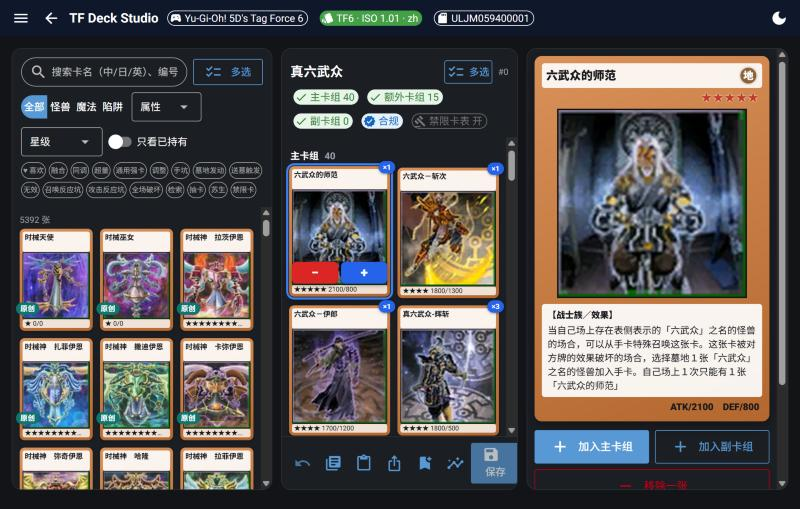

- Card browser with art and effect text from your own game disc image (ISO), search in
  Chinese, Japanese or English, and filters for attribute, level, Fusion/Synchro/Xyz, role tags and
  favourites.
- Deck checks against the save's ban list and the cards you own; similar-card suggestions for cards
  that are over the limit or missing from the game.
- Import from YDK files, ydke:// links and pasted deck lists. A deck library with the games' own
  recipes, Yugipedia character decks, YGOPRODeck imports and your own saved decks.
- Unsaved edits survive a page reload. A backup is made before every write.
- Optional sync with a TrimUI handheld over SSH (NextUI / NX Redux or spruceOS).
- Works on a PC browser and on a phone.

The app ships **no game data**. You need your own copy of the game (ISO) for card data and art.
The interface is in Simplified Chinese; this guide gives each button's Chinese label.

## Contents

1. [Install and start](#1-install-and-start)
2. [Start page: add the game and open a save](#2-start-page-add-the-game-and-open-a-save)
3. [The editor](#3-the-editor)
4. [Finding cards](#4-finding-cards)
5. [Card details, strong cards and favourites](#5-card-details-strong-cards-and-favourites)
6. [Editing a deck](#6-editing-a-deck)
7. [Deck library (卡组库)](#7-deck-library-卡组库)
8. [Decks from YGOPRODeck](#8-decks-from-ygoprodeck)
9. [Pasting a deck list](#9-pasting-a-deck-list)
10. [Deck analysis](#10-deck-analysis)
11. [Export and 我的卡组](#11-export-and-我的卡组)
12. [Saving to the game](#12-saving-to-the-game)
13. [Unsaved edits are kept](#13-unsaved-edits-are-kept)
14. [Using it on a phone](#14-using-it-on-a-phone)
15. [Handheld sync over SSH](#15-handheld-sync-over-ssh)
16. [Running it as a background service (Windows)](#16-running-it-as-a-background-service-windows)
17. [Where files are kept](#17-where-files-are-kept)
18. [Safety notes](#18-safety-notes)
19. [Command line tools](#19-command-line-tools)
20. [Development and tests](#20-development-and-tests)
21. [Licence and credits](#21-licence-and-credits)

## 1. Install and start

You need Python 3 (developed and tested on 3.13).

```
python -m venv .venv
.venv\Scripts\pip install -r requirements.txt
.venv\Scripts\python app\main.py --port 8080
```

On Linux or macOS use `.venv/bin/pip` and `.venv/bin/python`.

Open http://localhost:8080 in a browser. To use it from a phone on the same Wi-Fi, open
`http://<your PC's IP>:8080` there (the server listens on all network interfaces).

Options: `--port` (default 8080) and `--home <folder>` for the workspace folder (see
[section 17](#17-where-files-are-kept)). The same can be set with the `TFDS_PORT` and `TFDS_HOME`
environment variables.

## 2. Start page: add the game and open a save

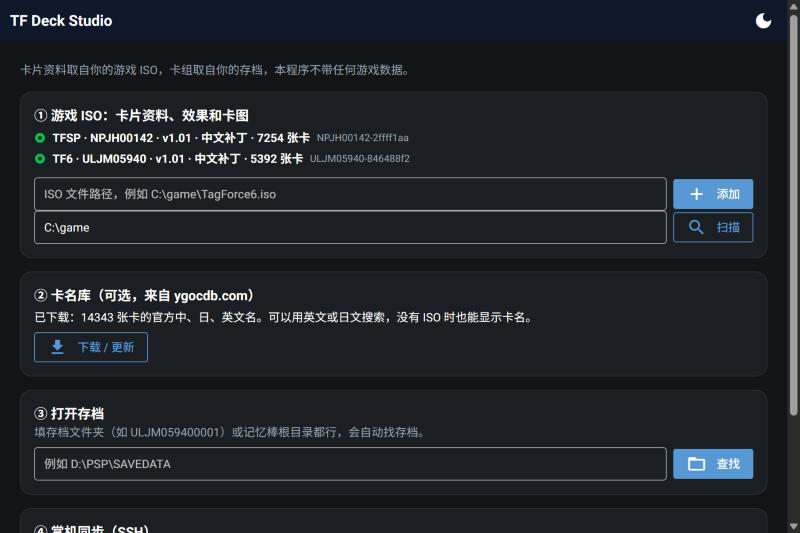

**① 游戏 ISO** — card data, effect text and art. Paste the path of your Tag Force 6 or Tag
Force Special ISO and press **添加** (add), or type a folder and press **扫描** (scan) to find
ISOs in it. The first time, the app reads the card table, the card art and the game's own deck
recipes from the ISO into a cache; this takes a minute. A green dot means the cache is ready. Both
Japanese and Chinese-patched discs work; the line shows the disc version and language.

**② 卡名库** (card names, optional) — **下载 / 更新** downloads the official Chinese,
Japanese and English names of all cards from ygocdb.com. With it you can search by English or
Japanese name, import English deck lists, and see names even without an ISO.

**③ 打开存档** (open a save) — paste the save folder (for example
`...\PSP\SAVEDATA\ULJM059400001`) or a whole memory stick / `SAVEDATA` folder and press **查找**
(find). Every Tag Force save found is listed with the game, the save title, play time and path.
Press **打开** (open) to edit it. Recently opened saves are listed here too.

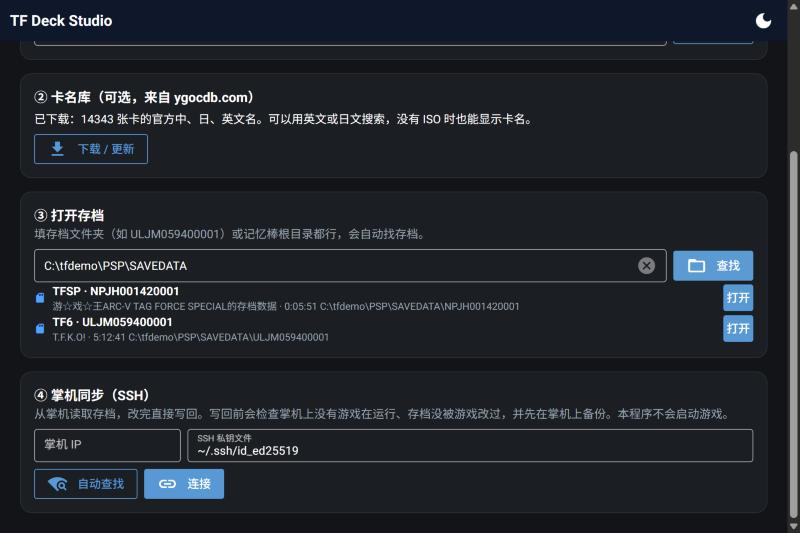

Without an ISO the app still opens saves: cards show as text (from the card name download) or as
card numbers, without art.

**④ 掌机同步** (handheld sync) — see [section 15](#15-handheld-sync-over-ssh).

## 3. The editor

On a PC the editor has three columns:

- **Left — card browser**: every card in the game, with search and filters.
- **Middle — the deck**: the deck you are editing, its checks, and the toolbar.
- **Right — card details**: the card you clicked, with its full text and buttons.

The header shows the game, the card source (ISO version and language) and the save folder. The
**☰** button opens the list of decks in the save; the **←** button goes back to the start page;
the moon button switches dark/light mode.

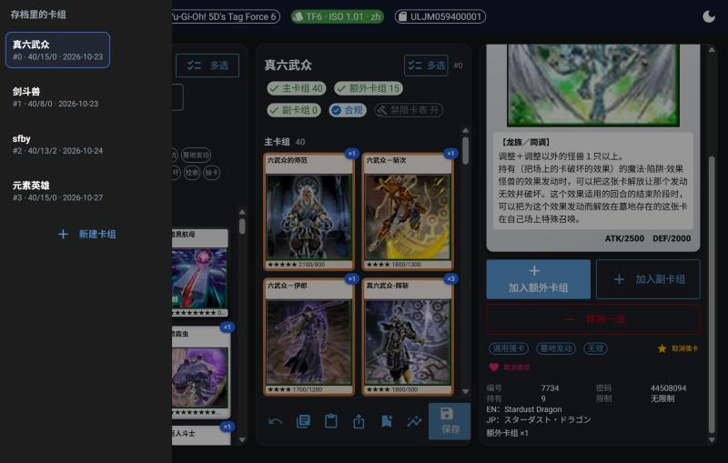

**存档里的卡组** (decks in the save) lists every deck slot with its number, card counts
(main/extra/side) and date. Click one to edit it, or **新建卡组** to start a new deck in a free
slot. A deck you have changed but not saved yet shows a **↺** button that puts it back to what is
in the save.

Each row also has **⧉ 复制到空位** (copy to a free slot, named `<name> 副本`) and **🗑 删除**
(delete). Both are unsaved edits like any other: nothing happens to the save until you press 保存,
the row stays with an ↺ until then, and 撤销 brings back what you changed. A deleted deck is
written out of the save on 保存 — the slot is empty afterwards, exactly as if you had deleted it in
the game.

## 4. Finding cards

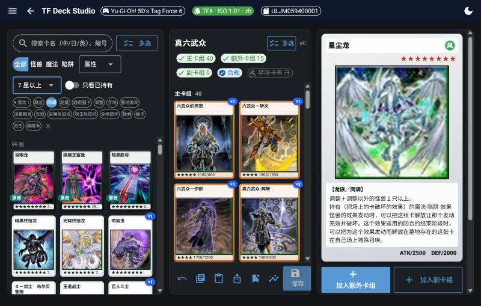

- **Search**: Chinese, Japanese or English names (English/Japanese need the card name
  download), the card number, the passcode, or a phrase from the effect text. Full-width/half-width
  characters and separators such as `·` are ignored, so `ehero` finds `Ｅ·ＨＥＲＯ`.
  Name and number matches come first, effect-text matches after them, so a card whose *name* has
  the phrase is not buried under cards that only mention it.
- **全部 / 怪兽 / 魔法 / 陷阱**: all, monsters, spells, traps.
- **属性**: attribute (光 暗 水 炎 地 风 神).
- **星级**: level — 1–4, 5–6, 7 or more, or one exact level 1–12. Xyz monsters count by rank.
  Spells and traps drop out while it is set.
- **只看已持有**: only cards you own in this save.
- **Chips** (click to turn on, click again to turn off; the **×** clears them):
  - **♥ 喜欢** — your favourite cards ([section 5](#5-card-details-strong-cards-and-favourites)).
  - **融合 / 同调 / 超量** — Fusion, Synchro (including Dark Synchro) and Xyz monsters. Picking
    two shows both kinds.
  - Role tags worked out from the card text: **通用强卡** (common strong cards), **调整**
    (Tuners, including Dark Tuners), **手坑** (hand traps), **墓地发动** (effects from the
    graveyard), **送墓触发** (triggers when sent to the graveyard), **无效** (negation),
    **召唤反应坑** / **攻击反应坑** (traps answering a summon / an attack), **全场破坏**
    (board wipes), **检索** (search), **抽卡** (draw), **苏生** (revive), **禁限卡**
    (forbidden or limited in this save's ban list).

  Role tags combine with each other and with the frame chips: 同调 + 调整 shows Synchro Tuners.

The count above the grid shows how many cards match. On each tile: the number of copies already
in the deck (blue), ban-list limit (red 禁 / 限1 / 限2), Tuner (green 调整), favourite (♥),
alternate artworks (异), game-original card (原创), and 🔒 when the game can't use the card.
Hovering a tile shows **+** to add it straight to the deck.

**多选** (multi-select) lets you tick several cards and add them all at once.

## 5. Card details, strong cards and favourites

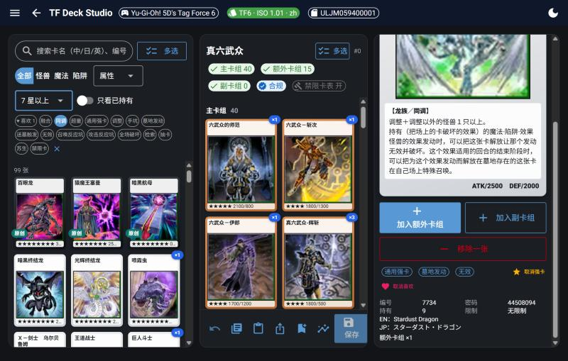

Clicking a card shows it full size with its type line — monster type (种族), frame and Tuner, for
example 【龙族／同调】 — its effect text and ATK/DEF. Cards with alternate art have arrows to
switch artwork.

Buttons:

- **加入主卡组 / 加入额外卡组** — add to the main deck, or the extra deck for Fusion, Synchro and
  Xyz monsters. **加入副卡组** adds to the side deck. **移除一张** removes one copy.
- **标为强卡 / 取消强卡** — add or remove the card from the 通用强卡 list (common strong cards).
  The app ships a short list; your changes are kept per game.
- **标为喜欢 / 取消喜欢** — mark the card as a favourite. Favourites show a ♥ on their tile and
  appear under the **♥ 喜欢** chip. They are shared by both games.

Below: the card's role tags, number (编号), passcode (密码), how many you own (持有) and the
ban-list limit (限制), plus the official English and Japanese names when the name download is
present, and how many copies are in the current deck.

## 6. Editing a deck

The middle column shows the deck name (click to rename), the counts of **主卡组** (main, 40–60),
**额外卡组** (extra, up to 15) and **副卡组** (side, up to 15), and **合规** (valid) when the deck
follows every rule. A red chip names the problem: too few or too many cards, more copies than the
ban list allows, more copies than you own, or a card the game doesn't have.

**禁限卡表 开 / 关** turns the save's ban list on or off for checking. Turned off, every card may be
played three times (owned counts still apply). This only changes the checks in the editor; turn
the ban list off in the game as well if you build a deck that needs it.

On a deck card, hover for **−** and **+**; click it for details. **多选** in the deck selects
several cards to move between main/extra/side or remove.

Toolbar at the bottom:

| Button | What it does |
|---|---|
| ↶ | Undo the last change |
| 📚 卡组库 | Open the deck library ([section 7](#7-deck-library-卡组库)) |
| 📋 | Paste a deck list ([section 9](#9-pasting-a-deck-list)) |
| ⇪ | Export the deck as text or YDK ([section 11](#11-export-and-我的卡组)) |
| 🔖 | Keep the deck in 我的卡组 ([section 11](#11-export-and-我的卡组)) |
| 📈 | Deck analysis ([section 10](#10-deck-analysis)) |
| 💾 保存（n） | Write the changes to the save; n = decks changed ([section 12](#12-saving-to-the-game)) |

## 7. Deck library (卡组库)

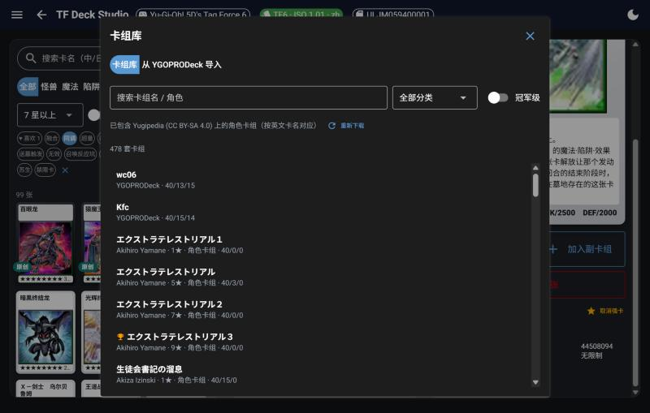

One list of every ready-made deck, filtered by the open game:

- **我的卡组** — decks you kept yourself (first in the list).
- **YGOPRODeck** — decks you imported from YGOPRODeck and saved.
- The game's own decks read from your ISO (Tag Force Special: character decks for every level,
  structure decks, starter decks and more).
- Character decks from Yugipedia (Tag Force 6; CC BY-SA 4.0), downloaded on request with
  **下载**. Each shows the character, the star level and 🏆 for the strongest version.

Search by deck or character name, filter by category, or turn on **冠军级** for the strongest
decks only. With a save open, **可组** narrows the list to the decks that save can play right
now — every copy owned and inside its ban list (with **按本游戏禁限卡表调整** on, the fitted deck
is what gets checked, because that is what 载入 hands over). The count then reads `12 / 841`.
Decks the list hides are still there; the switch is off by default.

Opening a deck shows its cards and how well it fits your save:

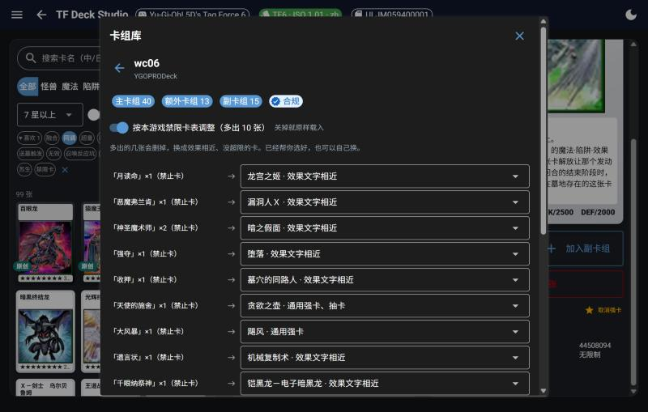

**按本游戏禁限卡表调整** (fit to this game's ban list) is on by default. Decks built for another
format often have more copies than the save allows. The app removes the extra copies and fills
each gap with a card that does a similar job, preferring common strong cards. Each row shows the
cut card and the suggested replacement with the reason (效果文字相近 similar effect text,
通用强卡 common strong card, 同为调整 also a Tuner, and so on). Pick another replacement from
the list if you like, or turn the switch off to load the deck as it is.

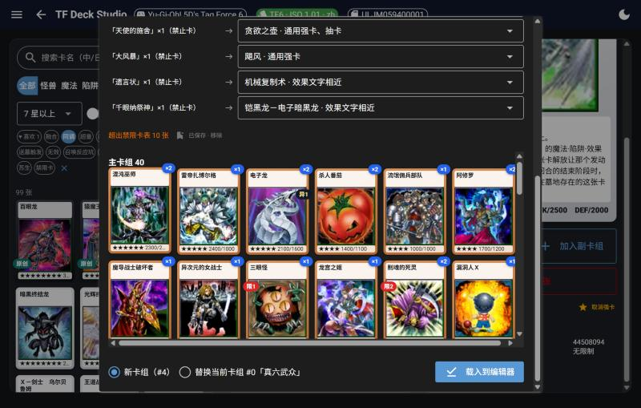

At the bottom, choose **新卡组** (into a free slot) or **替换当前卡组** (replace the deck you are
editing), then **载入到编辑器** (load into the editor). Nothing is written to the save until you
press 保存. **收藏缺 n 张** means you own fewer copies than the deck needs.

## 8. Decks from YGOPRODeck

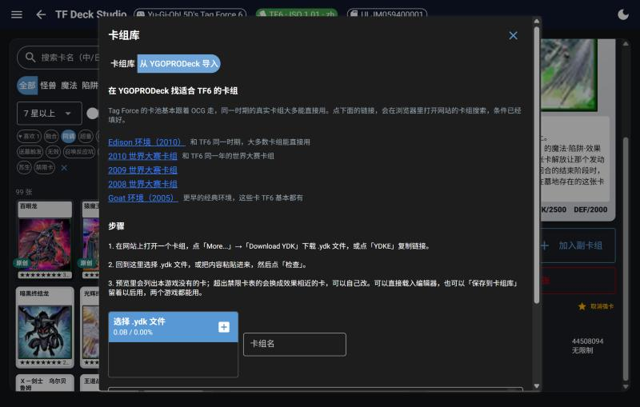

The **从 YGOPRODeck 导入** tab of the library has links to deck searches that suit the open game
(Tag Force 6: Edison format, World Championship 2008–2010, Goat format; Tag Force Special: World
Championship 2011–2014, Edison, Goat). The app does not download decks from the site.

1. Open a deck on the site and choose **More… → Download YDK**, or copy its **YDKE** link.
2. Back here, choose the .ydk file or paste the content, and press **检查** (check).
3. The preview lists cards this game doesn't have and swaps cards that are over the ban list, as in
   [section 7](#7-deck-library-卡组库). Load it into the editor, or **保存到卡组库** to keep it in
   the library for both games.

## 9. Pasting a deck list

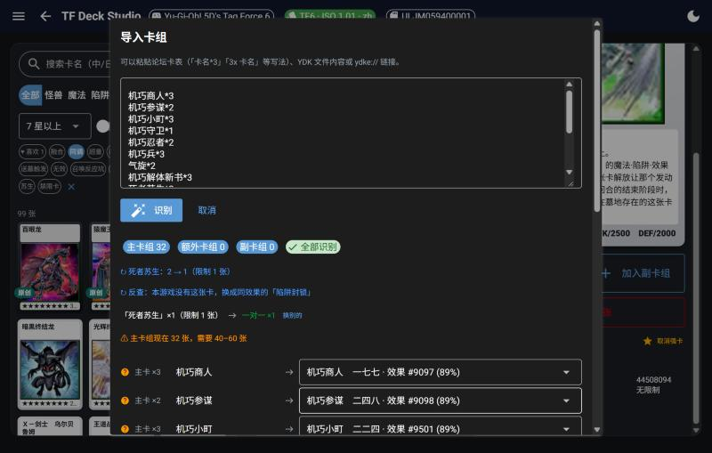

The 📋 button opens **导入卡组**. Paste forum deck lists (`卡名*3`, `3x 卡名`, Chinese, Japanese
or English names), YDK file content or a `ydke://` link, and press **识别** (recognise).

- Every line is matched to a card, with a confidence score. Lines marked ⚠ have several close
  matches: pick the right one from the list.
- Cards over the ban list are cut (`死者苏生：2 → 1`) and replaced with a similar card; cards the
  game doesn't have are swapped for a stand-in with the same effect (`反查 → 陷阱封锁`). Press
  **换别的** for another replacement or **只删掉，不补** to just remove it.
- Extra deck monsters go to the extra deck automatically. The deck size is checked.
- **导入到编辑器** puts the result into the current deck or a new slot.

## 10. Deck analysis

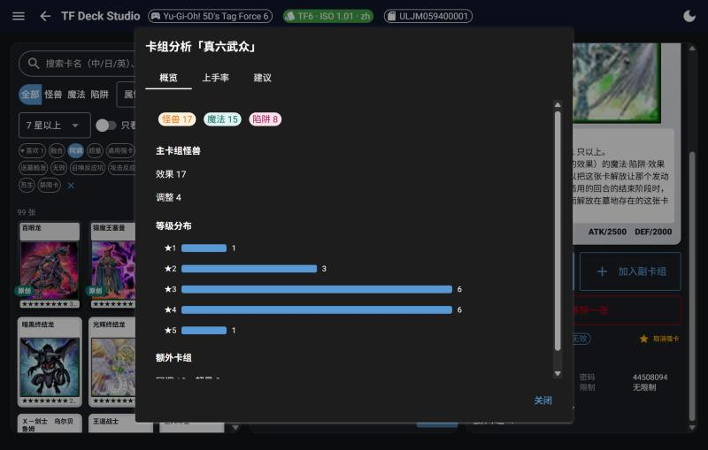

The 📈 button opens **卡组分析**:

- **概览** (overview): monster / spell / trap counts, monster kinds, Tuners, the level spread and
  the extra deck.
- **上手率** (opening-hand odds): for each card, the exact chance to have at least one copy in the
  opening hand when going first (5 cards), going second (6) and by your turns 2 and 3. Choose
  several cards under **组合** (for example all your starters) to see the chance of drawing any of
  them.
- **建议** (advice): rule-of-thumb notes — too few monsters, Synchro monsters without Tuners,
  Fusion monsters without a way to fusion summon, ritual monsters without ritual spells, many
  high-level monsters, many single copies.

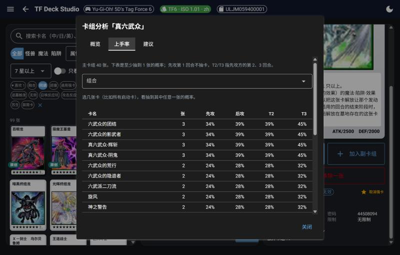

## 11. Export and 我的卡组

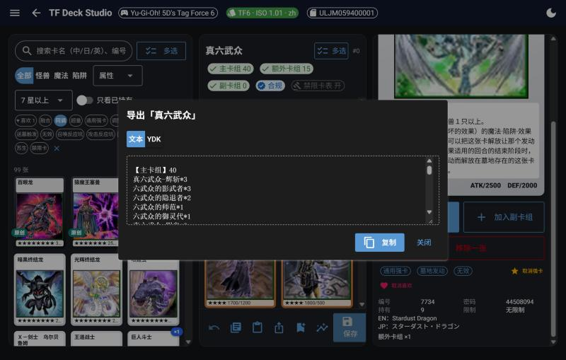

**导出** shows the deck as a Chinese text list (**文本**) or a **YDK** file to copy. YDK works in
EDOPro / YGOPro and on YGOPRODeck.

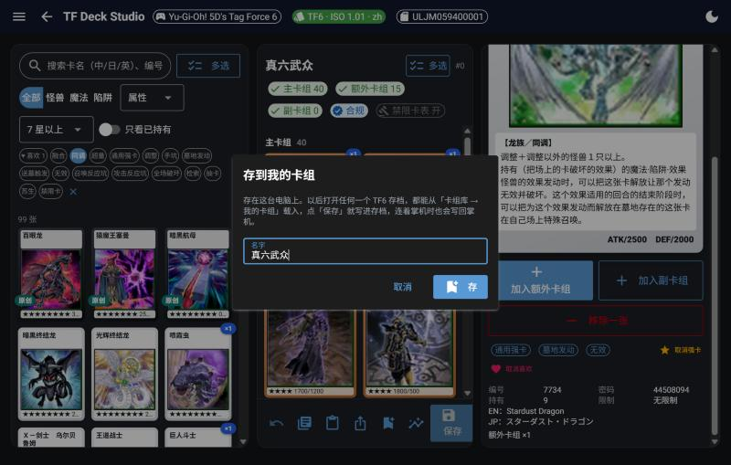

**存到我的卡组** keeps a copy of the deck on this computer. Later, in any save of the same game,
open **卡组库 → 我的卡组** to load it, then 保存 to put it in that save (and on your handheld, if
it is connected). Saving under an existing name replaces that deck. In the library, a kept deck
has **从我的卡组删除** to remove it.

## 12. Saving to the game

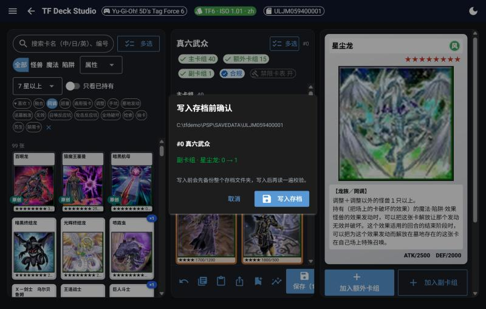

**保存** shows **写入存档前确认**: the save folder and every change per deck (cards added or removed
per section, renamed decks, deleted decks and the slots they free up). **写入存档** then:

1. backs up the whole save folder (see [section 17](#17-where-files-are-kept));
2. checks the save has not been changed by the game since you opened it — if it has, nothing is
   written and you are told to reopen it;
3. encrypts and writes the save, then reads it back to verify it.

Close the game (or the emulator) before saving, and start the game fresh afterwards.

## 13. Unsaved edits are kept

Every change is kept on this computer as you work, so a page reload, a closed tab or a restart of
the app loses nothing. When you open the save again, a yellow bar says which decks were restored:

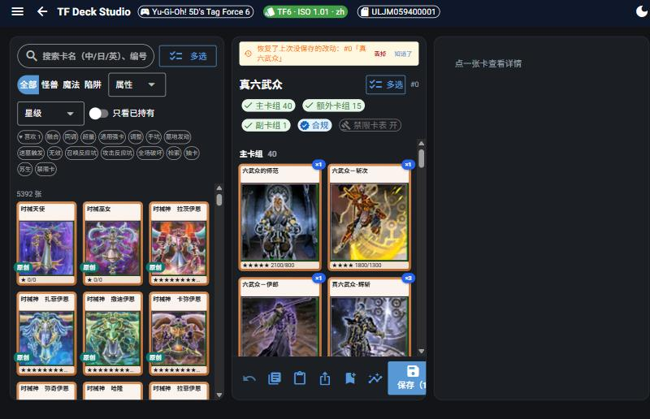

**知道了** hides the bar and keeps the edits; **丢掉** throws them away and shows the save as it
is. If the game changed a deck in the meantime, the bar says so and shows your version. Deleted
decks are restored too — a deleted deck is an unsaved edit like any other, and the bar names the
slots it took out.

## 14. Using it on a phone

The same page adapts to a phone: tabs at the bottom switch between **卡组** (the deck),
**卡片** (the card browser) and **列表** (the deck slots), and card details open as a sheet from the
bottom.

<p>
  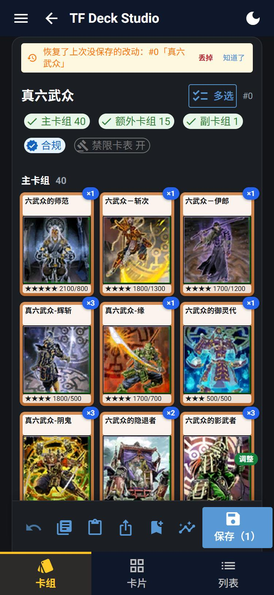
  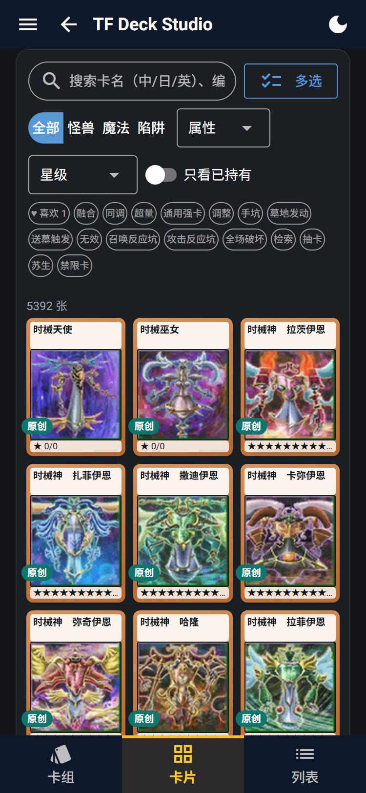
</p>

## 15. Handheld sync over SSH

For saves on a handheld running an emulator (tested with TrimUI Brick / Smart Pro S on NextUI,
NX Redux and spruceOS), the start page section **④ 掌机同步** reads saves straight from the
device and writes them back.

1. The handheld needs SSH on and a key login. Put your public key on the device (spruceOS needs
   the extra step in `device_setup/spruce_key_login.sh`). The app never asks for or stores a
   password.
2. Enter the handheld's IP (or press **自动查找** to scan the local network) and the private key
   file, then **连接**.
3. The Tag Force saves on the device are listed (the built-in PSP core's
   `Saves/PSP/SAVEDATA` and standalone PPSSPP's `Saves/.config/ppsspp/PSP/SAVEDATA`). Press
   **读取并编辑** to copy one to the PC and open it.
4. **保存** then writes the save locally **and** back to the handheld. Before writing, the app
   checks that no emulator is running on the device and that the save on the device has not
   changed since it was read, backs up the device copy on the device
   (`SAVEDATA_backup/<save>_<time>_before-push`), writes to a temporary file, renames it and
   verifies the checksum. If the handheld can't be reached, the changes stay on the PC and a
   **写回掌机** button lets you retry.

The app never starts a game on the handheld.

## 16. Running it as a background service (Windows)

`service.py` keeps the app running without a console window:

```
.venv\Scripts\python service.py start --port 8081
.venv\Scripts\python service.py status --port 8081
.venv\Scripts\python service.py logs --port 8081
.venv\Scripts\python service.py restart --port 8081
.venv\Scripts\python service.py stop --port 8081
.venv\Scripts\python service.py autostart enable --port 8081
```

`autostart enable` starts it when you log in to Windows (`disable` removes that).
`start_service_8081.bat` and `stop_service_8081.bat` do the same with a double click. Logs are in
`logs/`.

## 17. Where files are kept

The workspace folder is `%LOCALAPPDATA%\TFDeckStudio` on Windows (or the folder given with
`--home`). It holds:

| Path | Contents |
|---|---|
| `cache/<disc>-<hash>/` | Card table, art and recipes read from each ISO |
| `ygocdb/` | The card name download |
| `wiki/` | Downloaded Yugipedia character decks |
| `ygoprodeck/` | Saved YGOPRODeck decks and the passcode table |
| `mydecks.json` | 我的卡组 |
| `drafts/` | Unsaved edits, one file per save |
| `backups/` | A copy of the save folder before every write |
| `device/<ip>/` | Saves copied from a handheld |
| `config.json` | Recent saves, favourites, strong-card changes, device settings |

## 18. Safety notes

- Keep your own copy of your saves. The app backs up before each write, but it is an unofficial
  tool.
- Don't load an emulator save state (or a "resume" state) taken before an edit: it puts the old
  decks back in the game's memory, and the next in-game save writes them over your edit.
- The card collection (trunk) is not changed by the app; decks can only use cards you own.

## 19. Command line tools

`python -m tfcore.cli <command>` has tools for the save and card data: `catalog`, `pool`,
`passcodes`, `verify`, `decks`, `export` and `write`. For example `pool <iso>` (re)generates the
built-in card pool and the game-original card files from your ISO. Run
`python -m tfcore.cli <command> -h` for each command's options.

## 20. Development and tests

```
.venv\Scripts\python -m pytest
```

Most tests need your own ISOs and saves and are skipped without them: set `TF6_ISO` and `TFSP_ISO`
to the ISO paths and see `tests/conftest.py` for the save folders. `APP_PLAN.md` records the
design, the reverse-engineered formats and what was verified in-game. The screenshots in this
guide were taken from a demo workspace with test saves.

## 21. Licence and credits

GPL-3.0-or-later, see `LICENSE`. Credits, third-party licences and data sources are in
`CREDITS.md`.

Yu-Gi-Oh!, Tag Force and all card names, artwork and characters are trademarks and copyrights of
Konami. This is an unofficial, non-commercial fan tool, not affiliated with or endorsed by Konami.
Card images in the screenshots come from the game.
